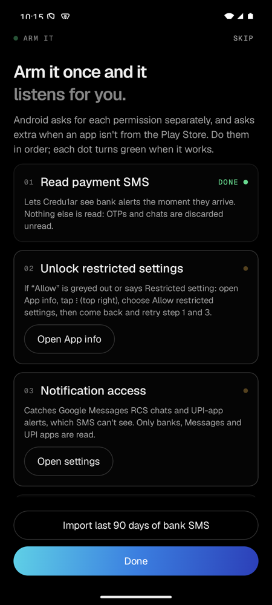
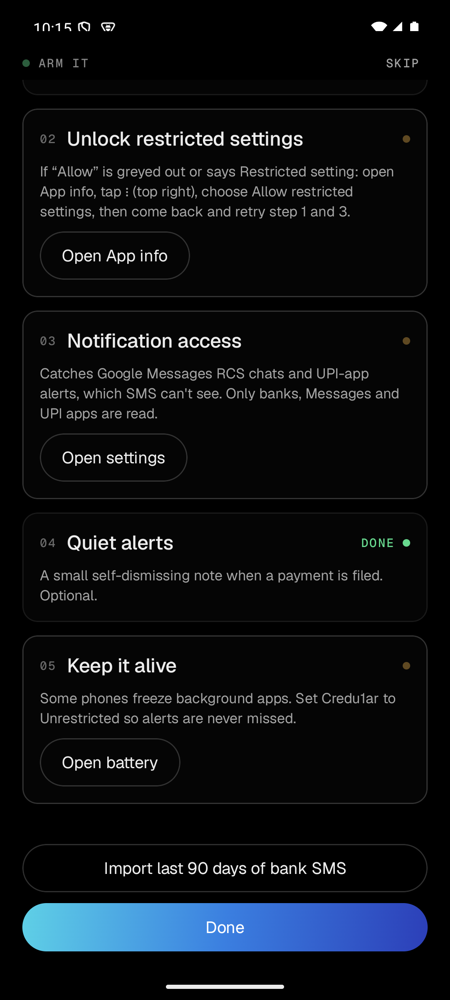
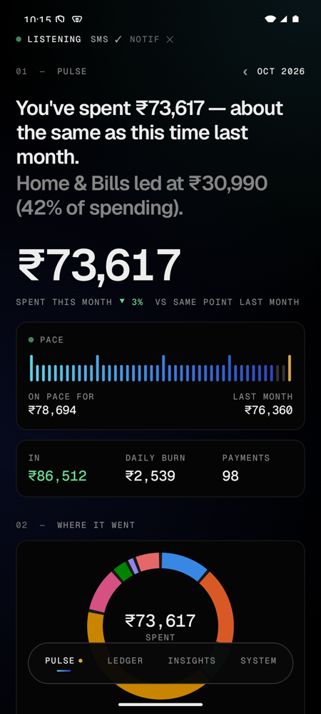
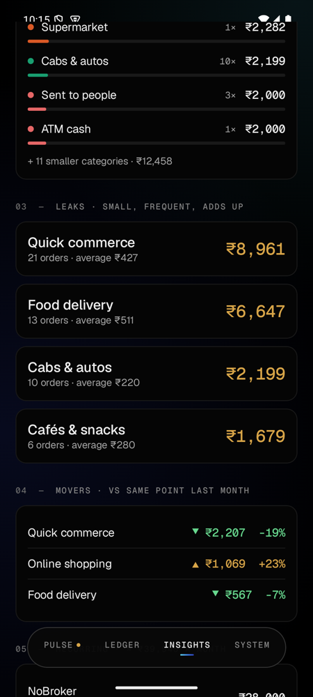
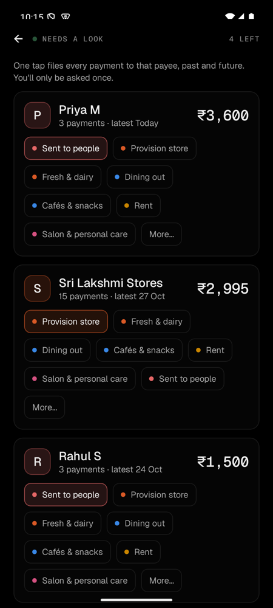

# Credu1ar

Know exactly where your money went. Credu1ar reads the payment SMS and notifications your phone already gets, files each one into a category (food delivery, quick commerce, provision store, bills…), and shows it in a fast, dark, instrument-style UI. **Everything stays on your phone** — no account, no server, no ads.

Android only (sideloaded APK, Android 8+). Personal project, not affiliated with any bank or payment app.

<p align="center">
  
  
  
  
  
</p>

<sub>Screens use fictional sample data from the emulator (Android 15). Pulse · Where it went · Ledger · Insights · Needs a look.</sub>

- **Why and roadmap:** [`PLAN.md`](PLAN.md)
- **Design language:** [`docs/DESIGN.md`](docs/DESIGN.md)
- **Day-by-day log:** [`plans/`](plans/README.md)
- **For coding agents:** [`AGENTS.md`](AGENTS.md)
- **Website:** [chiragjjjks.github.io/Credu1ar](https://chiragjjjks.github.io/Credu1ar/) · [source and deployment](site/README.md)

## Install

Download `Credu1ar-vX.Y.Z-android.apk` from [Releases](https://github.com/Chiragjjjks/Credu1ar/releases/latest) and open it.

Because Credu1ar reads your payment SMS, Google Play Protect in India **blocks** it when it is downloaded from a browser (it blocks every sideloaded app that asks for SMS). No app change can lift that. The reliable way in is installing from a computer over USB or Wi-Fi (`scripts/phone-install.sh`), which the block does not cover. On the phone alone you can try pausing **Play Protect → Scan apps** for the one install. Full steps, the "why not like OTP auto-fill" answer and the Android 13+ **Allow restricted settings** step: **[docs/INSTALL.md](docs/INSTALL.md)**.

## Develop

```bash
export JAVA_HOME=/opt/homebrew/opt/openjdk@17
export ANDROID_HOME=/opt/homebrew/share/android-commandlinetools
./gradlew :core:test                                  # parser, categoriser, insights (JVM, seconds)
./gradlew :app:testDebugUnitTest :app:assembleRelease # unit tests + signed APK
```

Test the whole pipeline on the emulator with fake bank SMS:

```bash
adb emu sms send HDFCBK "Rs.450.00 debited from A/c XX1234 on 29-10-26 to VPA zepto@axisbank (UPI Ref No 123456789012)"
```

## Release

Set the version in `gradle.properties` (`VERSION_NAME`, `VERSION_CODE`), add `docs/releases/vX.Y.Z.md`, push to `main`. CI runs tests, lint, builds a signed APK and smoke-tests it on an emulator. After the main build passes: `git tag vX.Y.Z && git push origin vX.Y.Z` publishes that exact tested APK with `SHA256SUMS.txt`. Releases need the owner's approval.

## Licence

Apache-2.0. Fonts: Geist and Geist Mono, SIL Open Font License 1.1.
